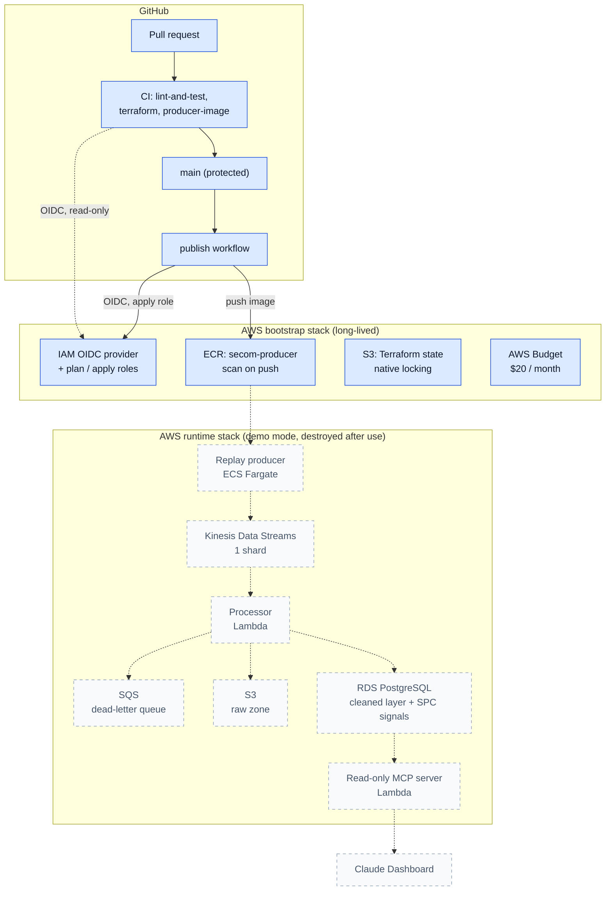

# SECOM Semiconductor Pipeline

A streaming data pipeline on AWS that watches a semiconductor fab's sensor data for a process drifting toward failure, using statistical process control (SPC).

It replays the real **SECOM** dataset (590 sensor measurements across 1,567 production runs from a wafer fab, each labelled pass or fail) as a simulated live stream. The pipeline validates and cleans each run, stores raw and cleaned data, computes SPC control limits, drift flags and a fail-risk indicator per run, and feeds a dashboard.

**The live stream is simulated.** SECOM is a fixed historical dataset. A replay producer publishes its runs in order, at a configurable rate, as if they were arriving off the line. Everything downstream treats it as a real feed.

> This README is updated every sprint. The status table says plainly what is built and what is still planned. **Current: Sprint 1 complete (October 2026).**

**Contents:** [Why](#why) · [Status](#status) · [Architecture](#architecture) · [Simulated stream](#how-the-live-stream-is-simulated) · [Record contract](#stream-record-contract) · [Data](#data) · [Data quality](#data-quality-figures) · [Testing and CI](#testing-and-ci) · [Security](#security) · [Cost controls](#cost-controls) · [Run it yourself](#run-it-yourself) · [Way of working](#way-of-working) · [Repo layout](#repo-layout)

## Why

I spent 30 years at Intel in high-volume semiconductor manufacturing (SPC, FMEA, engineering team leadership). This project rebuilds that way of thinking about yield and process control as a modern cloud data product.

## Status

| Component | Status |
|---|---|
| Repo, branch and pull-request workflow (protected `main`) | Built (Sprint 1) |
| Terraform with remote state in S3 (native locking) | Built (Sprint 1) |
| Keyless CI authentication (GitHub OIDC → IAM) | Built (Sprint 1) |
| AWS Budget and alerts, documented teardown | Built (Sprint 1) |
| CI checks required before merge (ruff, pytest, Terraform fmt/validate/plan) | Built (Sprint 1) |
| Shift-left security gate in CI: Bandit rules, pip-audit, Trivy config and image scans, Hadolint, secret push protection, Dependabot | Built (Sprint 2) |
| Stream record contract (JSON Schema, validator, reject reason codes) | Built (Sprint 1) |
| Replay producer: ordered replay, rate control, seeded chaos mode, container image built and smoke-tested in CI (local output; Kinesis in Sprint 2) | Built (Sprint 1) |
| Private image registry (Amazon ECR): immutable tags, scan on push, lifecycle policy; CI publishes the producer image on every merge to main via the keyless role | Built (Sprint 1) |
| Stream ingest, validation, storage, health signals, dashboard | Planned |

Nothing is running in production yet: the AWS foundations (state, keyless access, budget, image registry) are live, and the streaming runtime arrives in Sprint 2.

## Architecture

Solid boxes are built and in use. Dashed boxes are planned for later sprints.



**How data will flow.** The replay producer sends one record per production run to Kinesis. A Lambda processor reads the stream in batches, writes every record to the S3 raw zone, validates it against the [record contract](docs/record-contract.md), stores clean runs and rejects (with reason codes) in PostgreSQL, and computes SPC health signals. Batches that keep failing go to an SQS dead-letter queue so they can't block the stream. A read-only MCP server exposes the results to a Claude Dashboard.

**How code gets to AWS.** Every change goes through a pull request and three required CI checks. Merging to `main` triggers the publish workflow, which signs in to AWS without any stored keys and pushes a scanned producer image to ECR.

### AWS services

| Service | What it does in this project | Stack | Status |
|---|---|---|---|
| IAM + GitHub OIDC provider | Keyless sign-in for CI: a read-only plan role for pull requests, an apply role for `main` only | Bootstrap | Built |
| S3 (state bucket) | Terraform state for both stacks: versioned, encrypted, private, native locking | Bootstrap | Built |
| AWS Budgets | $20 monthly cost budget with email alerts at 50%, 80%, 100% and on forecast | Bootstrap | Built |
| Amazon SNS | `secom-alerts` topic: emails the maintainer when the publish workflow fails; CI may only publish to it | Bootstrap | Built (Sprint 2) |
| Amazon ECR | Private registry for the producer image: immutable commit-SHA tags, vulnerability scan on push, lifecycle policy | Bootstrap | Built |
| Kinesis Data Streams | The live stream: one shard keeps records in order and holds 24 hours for replay | Runtime | Planned (Sprint 2) |
| ECS Fargate | Runs the replay producer container, no servers to manage | Runtime | Planned (Sprint 2) |
| Lambda | Processor: validates records, writes raw and clean data, computes signals; later the read-only MCP server | Runtime | Planned (Sprint 2) |
| SQS | Dead-letter queue for batches the processor can't handle | Runtime | Planned (Sprint 2) |
| S3 (raw zone) | Every record exactly as received, including rejects, partitioned by date | Runtime | Planned (Sprint 2) |
| RDS PostgreSQL | Cleaned runs, control limits, SPC signals and the reject log; IAM database sign-in, no passwords in code | Runtime | Planned (Sprint 3) |
| CloudWatch | Logs, and alarms on stream lag and the dead-letter queue | Runtime | Planned |

Region: eu-west-1 (Ireland). All of it is Terraform.

## How the live stream is simulated

**The stream is a simulated replay of real fab data.** SECOM is a fixed, historical dataset, so a replay producer (`secom/producer.py`, in its own container) sends its 1,567 runs one at a time, in their original order, at a set rate, as if they were coming off the line now. Each record gets a fresh `sent_at` as its event time and keeps the run's real 2008 timestamp for reference.

A real feed is messy, so the producer has a seeded **chaos mode** that drops, duplicates, delays and corrupts records on purpose. At the end it prints exactly what it did, so the pipeline's own counts of gaps, duplicates, late records and rejects can be checked against the truth.

Details, settings and how to run it: [docs/replay-producer.md](docs/replay-producer.md).

## Stream record contract

Each production run travels the stream as one JSON record with a fixed contract: identity (`replay_id`, `seq`, `run_id`), times (`sent_at` as the event time, `original_ts` for reference), the pass/fail `label`, and exactly 590 sensor readings with `null` for missing.

- **Rejected** only when structurally broken, with one of ten reason codes (for example `WRONG_SENSOR_COUNT`, `BAD_TIMESTAMP`, `DUPLICATE`) so rejects can be counted by cause.
- **Accepted and flagged** for conditions that are normal in a real feed: missing readings, gaps in `seq`, late or out-of-order arrival.
- Defined twice and kept in step by tests: a Python validator (`secom/contract.py`) and a JSON Schema (`schemas/run-record.schema.json`).

Full field list, reason codes and an example: [docs/record-contract.md](docs/record-contract.md).

## Data

**Source:** McCann, M. & Johnston, A. (2008). *SECOM* [Dataset]. UCI Machine Learning Repository. https://doi.org/10.24432/C54305. Licensed under [Creative Commons Attribution 4.0 International (CC BY 4.0)](https://creativecommons.org/licenses/by/4.0/). The data is downloaded by script and never committed to this repo.

**What it is:** 1,567 production runs from a real semiconductor fab (July to October 2008), each with 590 sensor measurements and a pass/fail result from in-line testing.

**Data-quality profile** (full tables and charts: [docs/data-profile.md](docs/data-profile.md), generated by `scripts/profile_secom.py`):

| Finding | Value |
|---|---|
| Missing values | 4.5% of all readings; **every run** has at least one missing value |
| Sensors that never change | 116 of 590 |
| Sensors missing more than half their readings | 28 |
| Sensors worth a control chart (vary, at most 50% missing) | 446 |
| Pass / fail | 1,463 / 104 (about 14 passes per fail) |
| Runs sharing a timestamp with another run | 33 |

**What it means for the design:**

- A missing value is normal fab data, not an error: rejecting runs with gaps would reject all 1,567. The validator records missing values and rejects only structurally broken records.
- Records are identified by run number, not timestamp, because timestamps repeat.
- With fails this rare, fail-risk is measured by recall, precision and PR-AUC, never accuracy.

**Observations a fab engineer would make** (from the charts, my own reading):

- **Yield learning curve.** The weekly fail rate starts around 20% in late July and settles to a few percent from September, the shape of a process being brought under control. The SPC baseline should therefore come from the stable period, not the first runs, or the control limits will be too wide to catch anything.
- **Missing data comes in patterns, not at random.** The missing-value map shows whole sensors missing for long stretches, and the same missing pattern repeating across several blocks of columns, which suggests groups of measurements from the same tool or step. Some runs are missing many sensors at once, which looks like a tool or data-collection outage rather than noise.


## Data quality figures

Rows in, rows rejected and why will be reported here from the processor's own counts once it runs (Sprint 2), and reconciled against the replay producer's ground-truth summary. Until then, the measured properties of the source data are in the [data profile](docs/data-profile.md).

## Testing and CI

- **Every pull request runs CI** (GitHub Actions), and `main` only accepts a merge when all three required checks pass:
  - `lint-and-test`: ruff (lint and formatting) and pytest unit tests.
  - `terraform`: format check and validation of both Terraform stacks, then a `terraform plan` of the runtime stack, run in AWS through the keyless OIDC role.
  - `producer-image`: builds the producer container and runs it on a small fake dataset, checking every record against the contract.
- **On every merge to `main`**, the `publish` workflow pushes the producer image to ECR and fails if the vulnerability scan finds anything critical.
- **64 unit tests run offline** with no AWS calls or real data, covering the data profile, the record contract (the Python validator and the JSON Schema must agree on every bad example) and the replay producer (ordering, every chaos type, every corruption mapped to its reason code). Validation and health-signal logic get their own tests as they are built.
- **Proven, not assumed:** a test pull request with a deliberately failing test was blocked from merging ([screenshot](docs/evidence/secom-13-merge-blocked.png)), then closed.
- Details and the local commands: [docs/workflow.md](docs/workflow.md).

## Security

- **No long-lived AWS keys anywhere.** GitHub Actions signs in to AWS with GitHub OIDC: each run swaps a short-lived GitHub token for a one-hour IAM role session. The maintainer signs in with `aws login` (browser and MFA).
- **Two CI roles.** `secom-github-plan` is read-only and can be used by pull requests. `secom-github-apply` can change the runtime stack and can only be used from `main`.
- **CI can't widen its own permissions.** The OIDC provider, the CI roles, the budget and the state bucket live in the bootstrap stack, which only the maintainer applies. Explicit denies stop the apply role touching its own roles, the state bucket's settings, or any region except eu-west-1.
- **Shift-left security gate on every pull request.** Ruff's Bandit (`S`) rules, pip-audit, a Trivy config scan of the Terraform and Dockerfile, Hadolint, and a Trivy image scan all run inside the required CI checks, so a finding blocks the merge. GitHub secret scanning with push protection refuses pushes that contain credentials, and Dependabot opens weekly update pull requests.
- **The gate found real issues when it was switched on:** 26 known vulnerabilities in `pytest` and `pillow` (upgraded), and an over-broad `s3:*` permission on the CI apply role (narrowed). One finding is accepted on purpose, with the reason recorded: the state bucket uses AWS-managed rather than customer-managed encryption, to stay inside the $20 budget.
- **Supply chain:** third-party GitHub Actions are pinned to commit SHAs, and the security tools are downloaded with a checksum check, so a moved tag or a tampered release can't run in CI.

Full design: [docs/security.md](docs/security.md).

## Cost controls

- **Demo mode.** The services that bill by the hour (Kinesis, Fargate, RDS) live in the runtime stack, which is created for a demo and destroyed afterwards with `terraform destroy`. The long-lived bootstrap stack costs close to nothing.
- **AWS Budget of $20 a month** for the whole account, managed in Terraform. It emails an alert when actual spend passes 50%, 80% and 100%, and when AWS forecasts the month will go over.
- **Expensive defaults avoided on purpose:** no NAT gateway, no interface VPC endpoints, no customer-managed KMS keys.
- **Measured, not guessed:** from AWS's own price list, the runtime stack would cost about $42 a month if left running, and about $2 for a month of demos (20 hours of runtime).
- **Documented teardown**, including how to confirm nothing billable is left: [docs/teardown.md](docs/teardown.md). How each service is billed: [docs/costs.md](docs/costs.md).

## Run it yourself

### What is in place

- **GitHub repo with a protected `main` branch.** A branch ruleset (`protect-main`) applies to everyone, including the owner. Nobody can push straight to `main`, force-push over its history, or delete it. Every change arrives through a pull request.
- **One branch and pull request per Jira story**, merged with squash merge only, so each story becomes one commit on `main`. Merged branches are deleted automatically.
- **CI checks required before merge.** `lint-and-test`, `terraform` and `producer-image` are required checks in the `protect-main` ruleset, so a pull request can't merge until all three pass.
- **Terraform state in S3** from the first apply: a versioned, encrypted, private bucket with S3 native locking. See [docs/bootstrap.md](docs/bootstrap.md).

### Run it on your own copy

You need Terraform 1.11 or later, AWS CLI v2, and an AWS account where you can sign in with an admin profile.

```bash
git clone https://github.com/BBSISK/SECOM_Pipeline.git
cd SECOM_Pipeline
export AWS_PROFILE=<your-admin-profile>
./infra/bootstrap/bootstrap.sh
cd infra/runtime
terraform init -backend-config=../backend.hcl
terraform plan
```

`bootstrap.sh` creates a state bucket named after your own AWS account ID and writes `infra/backend.hcl` for you, so nothing in the code needs editing. It shows the plan and asks before creating anything.

To run the code without AWS (Python 3.12 or later):

```bash
python3 -m venv .venv
source .venv/bin/activate
python -m pip install -r requirements-dev.txt
python -m pytest
python scripts/profile_secom.py
RATE_SECONDS=1 MAX_RECORDS=5 python -m secom.producer
```

The profile script downloads SECOM from UCI into `data/raw/` (never committed) and regenerates the data profile; the last line replays five real runs, one a second.

## Way of working

Jira Scrum (two-week sprints), one branch and pull request per story, protected `main`. See [docs/workflow.md](docs/workflow.md).


### Sprint log

**Sprint 1 (12-25 October 2026): foundations, data and the replay producer. Complete.** Sprint goal: guardrails live, producer running locally on real data, README v1 public.

| Story | Delivered |
|---|---|
| SECOM-9 | Public repo, protected `main`, PR template, branch and squash-merge workflow |
| SECOM-10 | Terraform bootstrap with S3 remote state and native locking |
| SECOM-11 | GitHub OIDC to IAM: read-only plan role, main-only apply role, no stored keys |
| SECOM-12 | $20 AWS Budget with alerts, teardown guide, measured cost model |
| SECOM-13 | CI required before merge, proven by a deliberately failing pull request |
| SECOM-14 | SECOM data profile: missing values, dead sensors, class balance, time order |
| SECOM-15 | Replay producer with seeded chaos mode, container image, CI smoke test |
| SECOM-16 | Private ECR registry and automatic, scanned image publishing |
| SECOM-17 | Stream record contract: validator, JSON Schema, ten reject reason codes |
| SECOM-18 | README v1: architecture diagram and AWS service table |

**Sprint 2 (22 October - 4 November 2026): the live stream on AWS. In progress.** Sprint goal: records stream live from the producer on Fargate through Kinesis into a Lambda that validates them and lands raw data in S3, with reject counts reconciled against the chaos summary, behind a shift-left security gate.

| Story | Delivered |
|---|---|
| SECOM-19 | Shift-left security gate in CI; found and fixed 26 dependency vulnerabilities and an over-broad IAM permission; blocked a demo pull request with a vulnerable base image |

Still to come in Sprint 2: SNS alert channel, runtime network, demo-mode up and down workflows, Kinesis stream, producer on ECS Fargate writing to it, S3 raw zone, Lambda processor, and an end-to-end chaos replay. RDS PostgreSQL and the SPC signals follow in Sprint 3.

## Repo layout

| Path | What's there |
|---|---|
| `secom/` | The Python package: `profile.py` (data profile), `contract.py` (record contract), `producer.py` (replay producer) |
| `producer/Dockerfile` | Producer container image |
| `schemas/` | JSON Schema for the stream record |
| `scripts/` | Data profile, fake data, replay output checker, AWS price lookup |
| `tests/` | Unit tests (pytest) |
| `infra/bootstrap/` | Long-lived Terraform: state bucket, OIDC roles, budget, ECR |
| `infra/runtime/` | Demo-mode Terraform: the streaming services (Sprint 2) |
| `.github/workflows/` | `ci.yml` (required checks) and `publish.yml` (image to ECR) |
| `docs/` | Design notes, data profile, costs, teardown, security, evidence |

## Authorship

Designed, built and operated by Barry Sisk with AI assistance (Claude).

## Licence

MIT. See [LICENSE](LICENSE).
