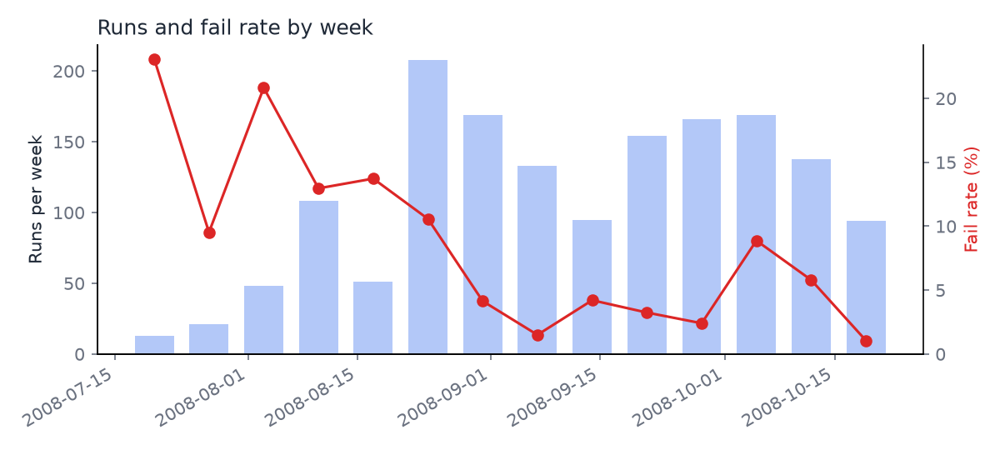

# SECOM Semiconductor Pipeline

A streaming data pipeline on AWS that watches a semiconductor fab's sensor data for a process drifting toward failure, using statistical process control (SPC).

It replays the real **SECOM** dataset (590 sensor measurements across 1,567 production runs from a wafer fab, each labelled pass or fail) as a simulated live stream. The pipeline validates and cleans each run, stores raw and cleaned data, computes SPC control limits, drift flags and a fail-risk indicator per run, and feeds a dashboard.

**The live stream is simulated.** SECOM is a fixed historical dataset. A replay producer publishes its runs in order, at a configurable rate, as if they were arriving off the line. Everything downstream treats it as a real feed.

> This README is updated every sprint. The status table below says plainly what is built and what is still planned.

## Why

I spent 30 years at Intel in high-volume semiconductor manufacturing (SPC, FMEA, engineering team leadership). This project rebuilds that way of thinking about yield and process control as a modern cloud data product.

## Status

| Component | Status |
|---|---|
| Repo, branch and pull-request workflow (protected `main`) | Built (Sprint 1) |
| Terraform with remote state in S3 (native locking) | Built (Sprint 1) |
| Keyless CI authentication (GitHub OIDC → IAM) | Built (Sprint 1) |
| AWS Budget and alerts, documented teardown | Built (Sprint 1) |
| CI checks required before merge (ruff, pytest, Terraform fmt/validate/plan) | Built (Sprint 1) |
| Stream record contract (JSON Schema, validator, reject reason codes) | Built (Sprint 1) |
| Replay producer: ordered replay, rate control, seeded chaos mode, container image built and smoke-tested in CI (local output; Kinesis in Sprint 2) | Built (Sprint 1) |
| Stream ingest, validation, storage, health signals, dashboard | Planned |

Nothing is running in production yet.

## Planned architecture

Replay producer (ECS Fargate) → Kinesis Data Streams → processor (Lambda, container image) → S3 raw zone and RDS PostgreSQL cleaned layer → SPC health signals → dashboard. All infrastructure in Terraform, region eu-west-1. A full diagram and service table arrive with README v1.

## Infrastructure

- **Terraform** for all infrastructure, with state in a versioned, encrypted, private S3 bucket and S3 native locking from the first apply. See [docs/bootstrap.md](docs/bootstrap.md).
- Two stacks: a long-lived **bootstrap** stack, and a **runtime** stack that is created for demos and destroyed afterwards to keep costs low.

## Set-up

### What is in place

- **GitHub repo with a protected `main` branch.** A branch ruleset (`protect-main`) applies to everyone, including the owner. Nobody can push straight to `main`, force-push over its history, or delete it. Every change arrives through a pull request.
- **One branch and pull request per Jira story**, merged with squash merge only, so each story becomes one commit on `main`. Merged branches are deleted automatically.
- **CI checks required before merge.** `lint-and-test` and `terraform` are required checks in the `protect-main` ruleset, so a pull request can't merge until both pass.
- **Terraform state in S3** from the first apply: a versioned, encrypted, private bucket with S3 native locking. See [docs/bootstrap.md](docs/bootstrap.md).

### Run it on your own copy

You need Terraform 1.11 or later, AWS CLI v2, and an AWS account where you can sign in with an admin profile.

```bash
git clone https://github.com/BBSISK/SECOM_Pipeline.git
cd SECOM_Pipeline
export AWS_PROFILE=<your-admin-profile>
./infra/bootstrap/bootstrap.sh
cd infra/runtime
terraform init -backend-config=../backend.hcl
terraform plan
```

`bootstrap.sh` creates a state bucket named after your own AWS account ID and writes `infra/backend.hcl` for you, so nothing in the code needs editing. It shows the plan and asks before creating anything.

## Testing and CI

- **Every pull request runs CI** (GitHub Actions), and `main` only accepts a merge when both checks pass:
  - `lint-and-test`: ruff (lint and formatting) and pytest unit tests.
  - `terraform`: format check and validation of both Terraform stacks, then a `terraform plan` of the runtime stack, run in AWS through the keyless OIDC role.
- **Unit tests run offline** with no AWS calls. Validation and health-signal logic get their own tests as they are built.
- **Proven, not assumed:** a test pull request with a deliberately failing test was blocked from merging ([screenshot](docs/evidence/secom-13-merge-blocked.png)), then closed.
- Details and the local commands: [docs/workflow.md](docs/workflow.md).

## Security

- **No long-lived AWS keys anywhere.** GitHub Actions signs in to AWS with GitHub OIDC: each run swaps a short-lived GitHub token for a one-hour IAM role session. The maintainer signs in with `aws login` (browser and MFA).
- **Two CI roles.** `secom-github-plan` is read-only and can be used by pull requests. `secom-github-apply` can change the runtime stack and can only be used from `main`.
- **CI can't widen its own permissions.** The OIDC provider, the CI roles, the budget and the state bucket live in the bootstrap stack, which only the maintainer applies. Explicit denies stop the apply role touching its own roles, the state bucket's settings, or any region except eu-west-1.

Full design: [docs/security.md](docs/security.md).

## Cost controls

- **Demo mode.** The services that bill by the hour (Kinesis, Fargate, RDS) live in the runtime stack, which is created for a demo and destroyed afterwards with `terraform destroy`. The long-lived bootstrap stack costs close to nothing.
- **AWS Budget of $20 a month** for the whole account, managed in Terraform. It emails an alert when actual spend passes 50%, 80% and 100%, and when AWS forecasts the month will go over.
- **Expensive defaults avoided on purpose:** no NAT gateway, no interface VPC endpoints, no customer-managed KMS keys.
- **Measured, not guessed:** from AWS's own price list, the runtime stack would cost about $42 a month if left running, and about $2 for a month of demos (20 hours of runtime).
- **Documented teardown**, including how to confirm nothing billable is left: [docs/teardown.md](docs/teardown.md). How each service is billed: [docs/costs.md](docs/costs.md).

## Way of working

Jira Scrum (two-week sprints), one branch and pull request per story, protected `main`. See [docs/workflow.md](docs/workflow.md).

## How the live stream is simulated

**The stream is a simulated replay of real fab data.** SECOM is a fixed, historical dataset, so a replay producer (`secom/producer.py`, in its own container) sends its 1,567 runs one at a time, in their original order, at a set rate, as if they were coming off the line now. Each record gets a fresh `sent_at` as its event time and keeps the run's real 2008 timestamp for reference.

A real feed is messy, so the producer has a seeded **chaos mode** that drops, duplicates, delays and corrupts records on purpose. At the end it prints exactly what it did, so the pipeline's own counts of gaps, duplicates, late records and rejects can be checked against the truth.

Details, settings and how to run it: [docs/replay-producer.md](docs/replay-producer.md).

## Stream record contract

Each production run travels the stream as one JSON record with a fixed contract: identity (`replay_id`, `seq`, `run_id`), times (`sent_at` as the event time, `original_ts` for reference), the pass/fail `label`, and exactly 590 sensor readings with `null` for missing.

- **Rejected** only when structurally broken, with one of ten reason codes (for example `WRONG_SENSOR_COUNT`, `BAD_TIMESTAMP`, `DUPLICATE`) so rejects can be counted by cause.
- **Accepted and flagged** for conditions that are normal in a real feed: missing readings, gaps in `seq`, late or out-of-order arrival.
- Defined twice and kept in step by tests: a Python validator (`secom/contract.py`) and a JSON Schema (`schemas/run-record.schema.json`).

Full field list, reason codes and an example: [docs/record-contract.md](docs/record-contract.md).

## Data

**Source:** McCann, M. & Johnston, A. (2008). *SECOM* [Dataset]. UCI Machine Learning Repository. https://doi.org/10.24432/C54305. Licensed under [Creative Commons Attribution 4.0 International (CC BY 4.0)](https://creativecommons.org/licenses/by/4.0/). The data is downloaded by script and never committed to this repo.

**What it is:** 1,567 production runs from a real semiconductor fab (July to October 2008), each with 590 sensor measurements and a pass/fail result from in-line testing.

**Data-quality profile** (full tables and charts: [docs/data-profile.md](docs/data-profile.md), generated by `scripts/profile_secom.py`):

| Finding | Value |
|---|---|
| Missing values | 4.5% of all readings; **every run** has at least one missing value |
| Sensors that never change | 116 of 590 |
| Sensors missing more than half their readings | 28 |
| Sensors worth a control chart (vary, at most 50% missing) | 446 |
| Pass / fail | 1,463 / 104 (about 14 passes per fail) |
| Runs sharing a timestamp with another run | 33 |

**What it means for the design:**

- A missing value is normal fab data, not an error: rejecting runs with gaps would reject all 1,567. The validator records missing values and rejects only structurally broken records.
- Records are identified by run number, not timestamp, because timestamps repeat.
- With fails this rare, fail-risk is measured by recall, precision and PR-AUC, never accuracy.

**Observations a fab engineer would make** (from the charts, my own reading):

- **Yield learning curve.** The weekly fail rate starts around 20% in late July and settles to a few percent from September, the shape of a process being brought under control. The SPC baseline should therefore come from the stable period, not the first runs, or the control limits will be too wide to catch anything.
- **Missing data comes in patterns, not at random.** The missing-value map shows whole sensors missing for long stretches, and the same missing pattern repeating across several blocks of columns, which suggests groups of measurements from the same tool or step. Some runs are missing many sensors at once, which looks like a tool or data-collection outage rather than noise.



## Authorship

Designed, built and operated by Barry Sisk with AI assistance (Claude).

## Licence

MIT. See [LICENSE](LICENSE).
