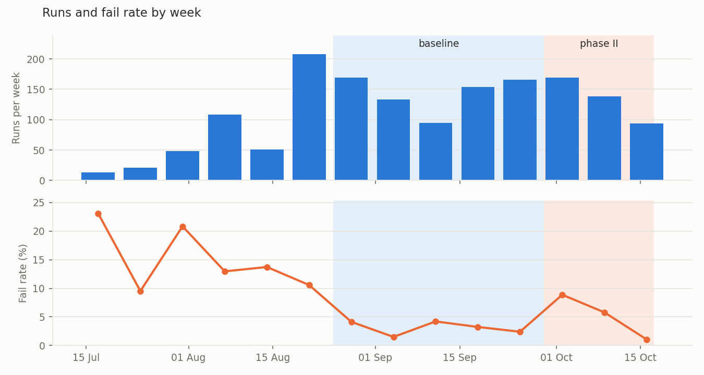
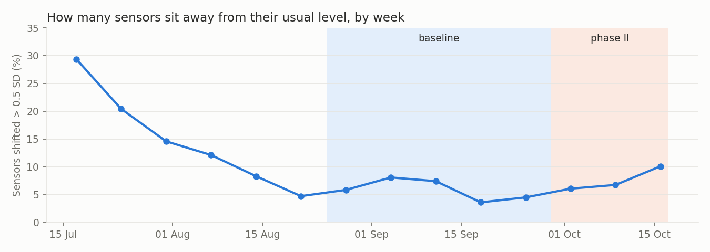
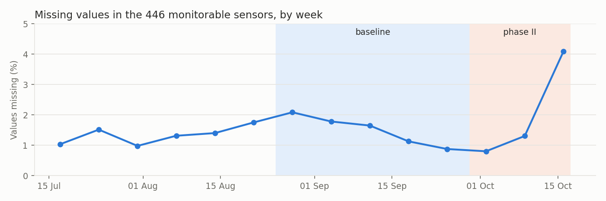
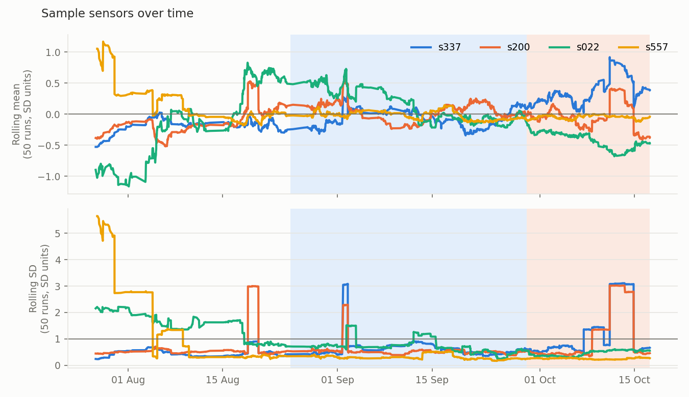

# SPC Phase I: the baseline window (SECOM-29)

Generated by `scripts/spc_baseline.py`. Control limits (SECOM-30) are set from a **baseline** period
when the process was running normally; every run after it is **Phase II**, judged against those limits
and never used to set them.

## Decision

| | From | To | Runs | Fails | Fail rate |
|---|---|---|---|---|---|
| Ramp-up (not used) | 19 Jul 2008 | 24 Aug 2008 | 449 | 58 | 12.9% |
| **Baseline (Phase I)** | **25 Aug 2008** | **28 Sep 2008** | **717** | **22** | **3.1%** |
| Phase II (monitoring) | 29 Sep 2008 | 17 Oct 2008 | 401 | 24 | 6.0% |

- **Window: 25 Aug to 28 Sep 2008.** Before it, the line was ramping up; it ends just before an
  early-October excursion, so Phase II contains a real problem for the charts to catch.
- **All runs in the window, passes and fails** (label-blind, as in classic SPC). The alternative,
  passing runs only, is discussed below.
- Sensors: the 446 monitorable sensors from the data profile (vary, and at most 50% missing).
  6 of them never change inside the baseline (`s074`, `s206`, `s209`, `s342`, `s347`, `s478`),
  so they can't have control limits; SECOM-30 lists them as not charted.

The window is also written to `docs/analysis/baseline.json` for SECOM-30 to read.

## Why this window

**Fail rate.** July to mid-August fails at 9.5-23% a week, mostly on low volume. From the week of 25 Aug it
drops to 1.5-4% and stays there for five weeks. In the week of 29 Sep it jumps to 8.9%, with 17 fails
between 2 and 6 Oct.

**Sensor behaviour.** For each sensor and week, the shift is how far that week's mean sits from the
sensor's whole-period mean, in standard deviations. In the first weeks, 15-29% of sensors sit more than
0.5 SD away: the process is still settling. From 18 Aug it is 4-8% and flat through the baseline. So the
sensors settle about a week before
the fail rate does; starting at 25 Aug waits for both.

**Missing values** stay at 0.9-2.1% a week through the baseline. They jump to 4.1% in the last
(partial) week of October, a data-collection change worth knowing about in Phase II.

Two outlier-dominated sensors (`s337`, `s200`) and two typical ones
(`s022`, `s557`,
picked at random with a fixed seed), as 50-run rolling mean and rolling SD in whole-period SD units. The
square steps in the rolling SD are single extreme runs entering and leaving the 50-run window; `s337`
and `s200` step together because the same runs are extreme in both. `s022` drifts about
0.7 SD below its baseline level through Phase II: a slow drift for the EWMA chart to catch (SECOM-31).

### Weekly figures

| Week of | Runs | Fails | Fail rate | Sensors shifted > 0.5 SD | Missing |
|---|---|---|---|---|---|
| 14 Jul | 13.0 | 3.0 | 23.1% | 29% | 1.0% |
| 21 Jul | 21.0 | 2.0 | 9.5% | 20% | 1.5% |
| 28 Jul | 48.0 | 10.0 | 20.8% | 15% | 1.0% |
| 04 Aug | 108.0 | 14.0 | 13.0% | 12% | 1.3% |
| 11 Aug | 51.0 | 7.0 | 13.7% | 8% | 1.4% |
| 18 Aug | 208.0 | 22.0 | 10.6% | 5% | 1.8% |
| 25 Aug | 169.0 | 7.0 | 4.1% | 6% | 2.1% |
| 01 Sep | 133.0 | 2.0 | 1.5% | 8% | 1.8% |
| 08 Sep | 95.0 | 4.0 | 4.2% | 7% | 1.6% |
| 15 Sep | 154.0 | 5.0 | 3.2% | 4% | 1.1% |
| 22 Sep | 166.0 | 4.0 | 2.4% | 4% | 0.9% |
| 29 Sep | 169.0 | 15.0 | 8.9% | 6% | 0.8% |
| 06 Oct | 138.0 | 8.0 | 5.8% | 7% | 1.3% |
| 13 Oct | 94.0 | 1.0 | 1.1% | 10% | 4.1% |

## How stable is the baseline itself?

- **Slow drift inside the window.** Comparing the first and second halves of the baseline, the median
  sensor moves 0.15 SD, and 11% of sensors move more
  than 0.5 SD.
  A perfectly steady process would give about 0.05 SD by chance. So the "stable" period still
  drifts a little. I-MR limits come from run-to-run variation, so drifting sensors will signal more
  often; SECOM-30 and SECOM-31 have to allow for it.
- **Runs are close to independent.** The median lag-1 autocorrelation across sensors is
  0.04, and only 7% of sensors are above 0.3, so
  individuals (I-MR)
  charts are a reasonable choice.

## All runs, or passing runs only?

Decided: **all runs** in the window. The trade-off:

- **All runs (chosen):** classic SPC. The baseline is whatever the process did, without looking at
  test results. Points that fall outside the first limits are reviewed and removed in SECOM-30's
  Phase I clean-up instead.
- **Passing runs only:** limits describe good production. In a real fab the test result arrives after
  the run, so this would be legitimate, but it mixes the labels into SPC.

For most sensors it makes no difference: dropping the 22 fails changes the median sensor's
spread by a factor of 1.002. For
25 sensors it cuts the spread by more than 10%. On a closer look that is **not** because those
sensors are noisy on failing runs in general: in each of them one run sits 11-22 SD from the mean, and in
14 of the 25 that single run is a fail. Remove it and the spread
drops by the
same amount whatever its label.

| Sensor | Spread with passes only / all runs | Most extreme run | That run |
|---|---|---|---|
| `s337` | 0.57 | 634 | fail |
| `s200` | 0.65 | 634 | fail |
| `s475` | 0.68 | 634 | fail |
| `s203` | 0.72 | 634 | fail |
| `s202` | 0.77 | 634 | fail |
| `s338` | 0.78 | 634 | fail |
| `s471` | 0.78 | 634 | fail |
| `s067` | 0.80 | 457 | pass |
| `s339` | 0.81 | 457 | pass |
| `s198` | 0.81 | 634 | fail |
| `s334` | 0.81 | 634 | fail |
| `s340` | 0.82 | 466 | pass |
| `s196` | 0.83 | 457 | pass |
| `s204` | 0.83 | 466 | pass |
| `s437` | 0.83 | 576 | fail |
| `s470` | 0.84 | 634 | fail |
| `s199` | 0.84 | 457 | pass |
| `s197` | 0.85 | 457 | pass |
| `s166` | 0.86 | 576 | fail |
| `s469` | 0.87 | 457 | pass |
| `s479` | 0.87 | 457 | pass |
| `s333` | 0.88 | 457 | pass |
| `s201` | 0.88 | 634 | fail |
| `s068` | 0.89 | 634 | fail |
| `s477` | 0.90 | 457 | pass |

## Extreme runs and heavy tails

The outliers are **whole-run events**, not single sensors misbehaving. Measured on a robust scale
(median and MAD, which the outliers can't drag around), these baseline runs have the most sensors beyond
10 robust SDs at once:

| Run | When | Result | Sensors beyond 10 robust SD |
|---|---|---|---|
| 634 | 01 Sep 19:54 | fail | 45 |
| 457 | 27 Aug 22:58 | pass | 39 |
| 466 | 28 Aug 05:00 | pass | 36 |
| 1123 | 27 Sep 11:45 | pass | 23 |
| 497 | 28 Aug 21:52 | pass | 20 |
| 800 | 12 Sep 06:38 | pass | 20 |
| 709 | 03 Sep 01:15 | fail | 20 |
| 539 | 29 Aug 15:01 | pass | 17 |
| 956 | 20 Sep 15:19 | pass | 17 |
| 856 | 15 Sep 22:54 | pass | 16 |

And the tails are heavy everywhere: 313 of the 717 baseline runs have five or more
sensors beyond
6 robust SDs. SECOM sensors are far from normal, so textbook three-sigma limits will flag far more than
0.27% of runs.

What this means for the next stories:

- **SECOM-30 (control limits)** must do a proper Phase I clean-up (remove gross outliers such as the runs
  above, recompute) and decide how to set limits for heavy-tailed sensors, for example from the moving
  range (which one outlier inflates less than the SD) or from empirical percentiles.
- **SECOM-32 (do signals warn before a fail?)** has an early hint to test properly: in the baseline,
  64% of failing runs have five or more extreme sensors, against
  43% of passing runs.
  Not a conclusion yet: the baseline has only 22 fails.

## Phase II

The 401 runs from 29 Sep onwards (24 fails, 6.0%) are
held out. They are
used only to test the limits, in time order (SECOM-31), with no peeking while the limits are set.
