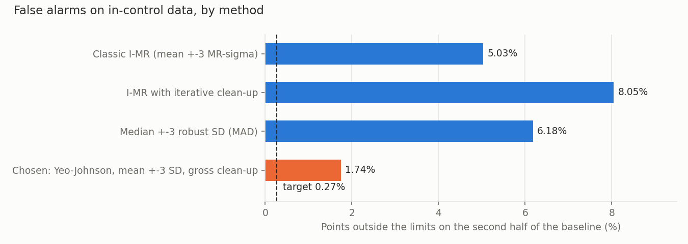
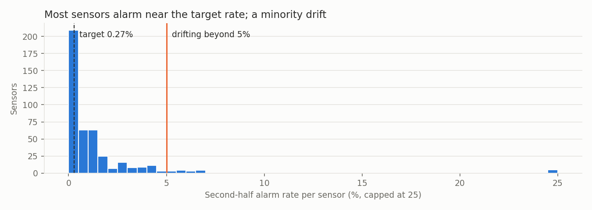
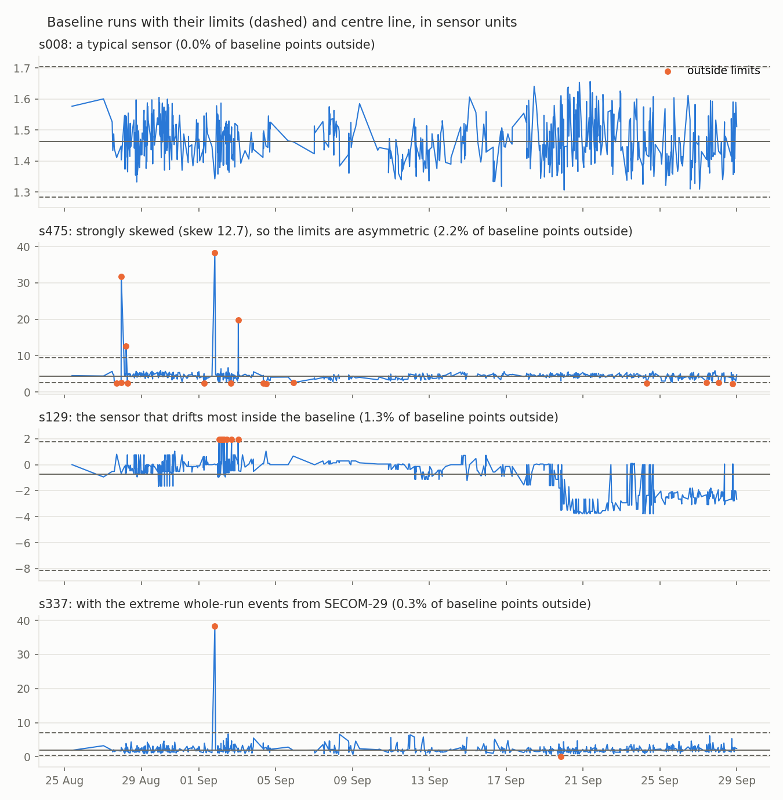

# SPC Phase I: control limits (SECOM-30)

Generated by `scripts/spc_limits.py` from the baseline window chosen in SECOM-29
(25 Aug to 28 Sep 2008, 717 runs). Phase II runs are not read here.

## Decision

Each sensor gets limits set like this:

1. **Standardise and transform**: subtract the baseline median, divide by the baseline SD, then apply a
   Yeo-Johnson power transform with the sensor's own lambda (maximum likelihood). Standardising first
   matters: the transform is not scale-invariant, and on raw values in the thousands it collapses
   numerically (an early version produced 29 sensors with zero-width limits). Lambda is kept between
   0 and 2: outside that range the transform squeezes one tail into a bounded interval, a limit on that
   side can match no real sensor value, and extreme values there could never signal (an early version
   left 37 sensors without an upper limit, including ones with the whole-run outliers from SECOM-29).
2. **Clean up gross outliers only**: points more than 6 SD from the mean after the transform are removed,
   once. That took out 274 of 310,032 values.
3. **Limits at mean +-3 SD** of the cleaned, transformed values. Mapped back to sensor units they are
   usually asymmetric: a skewed sensor gets a longer allowance on its long-tail side.

A new value is a signal when its transformed value falls outside the limits. The transform is plain
NumPy in `secom/spc.py`, so the processor (SECOM-27) can apply these limits without SciPy.

**439 sensors are charted.** The other 7 monitorable sensors are constant inside the
baseline,
or constant once their gross outliers are removed (`s074`, `s206`, `s209`, `s342`, `s347`, `s478`, `s521`), so they
can't have limits. Lambda sits at the bottom of its range (0, a log transform) for
162 sensors and at the top (2) for 9: those are
skewed beyond what the transform can fully correct.

The full table is `docs/analysis/control-limits.csv`: sensor, n, the standardising median and
SD (`loc`, `scale`), lambda, centre and SD on the transformed scale, limits on both scales,
MR-bar, gross outliers removed, and the flags below.

## Why not textbook I-MR?

The usual individuals chart sets limits at centre +-2.66 x MR-bar (3 sigma, with sigma estimated from
the average moving range). To compare methods without looking at Phase II, each one was fitted on the
first half of the baseline and checked on the second half, which is still in control. A method that fits
should put about **0.27%** of those points outside its limits.

| Method | Second-half alarm rate | Times the target |
|---|---|---|
| Classic I-MR (mean +-3 MR-sigma) | 5.03% | 19x |
| I-MR with iterative clean-up | 8.05% | 30x |
| Median +-3 robust SD (MAD) | 6.18% | 23x |
| Chosen: Yeo-Johnson, mean +-3 SD, gross clean-up | 1.74% | 6x |

Three things push the textbook method off:

- **Heavy tails.** Before the transform the median sensor has skew 1.1, and
  240 of 439 sensors have |skew| above 1. After it, the median skew
  is 0.05 and 61 sensors stay above 1.
- **The moving range under-estimates the spread.** Neighbouring runs are more alike than runs far
  apart, so sigma from MR-bar is a median 0.84 of the plain SD (10th percentile
  0.56). Limits built on it are too narrow. MR-bar is still in the table.
- **Iterative clean-up makes it worse.** Removing every point outside the limits and recomputing
  narrows the limits each round, so more points fall outside next time. Only gross outliers are removed.

## How well the chosen limits fit

Per sensor, with limits from the first half: the median sensor alarms on
0.56% of second-half points, about 2 times the 0.27% target.
(Without the 0-2 bound on lambda it was 0.28%, but 37 sensors could then never alarm on their high side;
that trade is deliberate.) The pooled
rate is higher (1.74%) because a minority drift: **25 sensors alarm on more than 5%**
and are flagged `drifting`.

| Most drifting sensors | Second-half alarm rate | Skew before transform |
|---|---|---|
| `s129` | 66.3% | -0.6 |
| `s542` | 64.9% | 0.8 |
| `s544` | 40.4% | 0.7 |
| `s543` | 35.1% | 3.0 |
| `s545` | 32.9% | 3.0 |
| `s122` | 20.6% | 0.8 |
| `s116` | 15.6% | -3.2 |
| `s004` | 11.9% | 2.4 |
| `s006` | 9.9% | -0.8 |
| `s038` | 8.6% | 0.3 |
| `s527` | 7.8% | -0.1 |
| `s255` | 7.0% | -0.1 |
| `s175` | 6.7% | 0.4 |
| `s446` | 6.7% | 0.4 |
| `s039` | 6.7% | 4.9 |

Other flags: 61 sensors `non_normal` (|skew| still above 1 after the transform)
and 6 sensors `discrete` (fewer than 20 distinct baseline values, where a
continuous transform is a rough fit). Their limits are kept but should be read with that in mind.

The drifting example, `s129`, shows why that flag matters: it steps down to a new level around
19 Sep, inside the baseline, so for this sensor the "in-control" period is not in control and its limits
are stretched to cover both levels. Drifting sensors need their own treatment in Phase II rather than
these limits alone.

## What this means for Phase II (SECOM-31)

Even limits that fit perfectly would flag 0.27% x 439 sensors = **1.2 points per run** by
chance; at the measured 1.74% it is about **8 per run**. So a single
out-of-limit point on one sensor means little. SECOM-31 should work per run: count signals, compare the
count with what the baseline produces, and treat the drifting sensors separately (EWMA is built for slow
drift).
