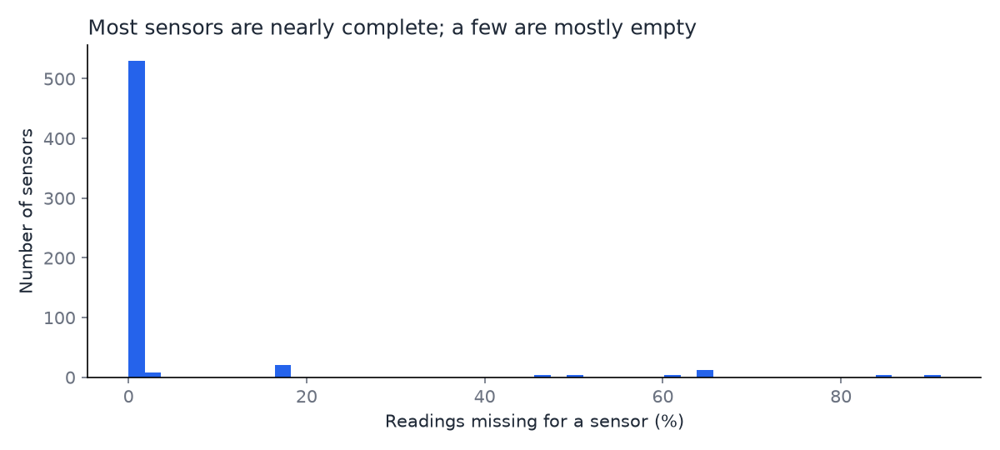
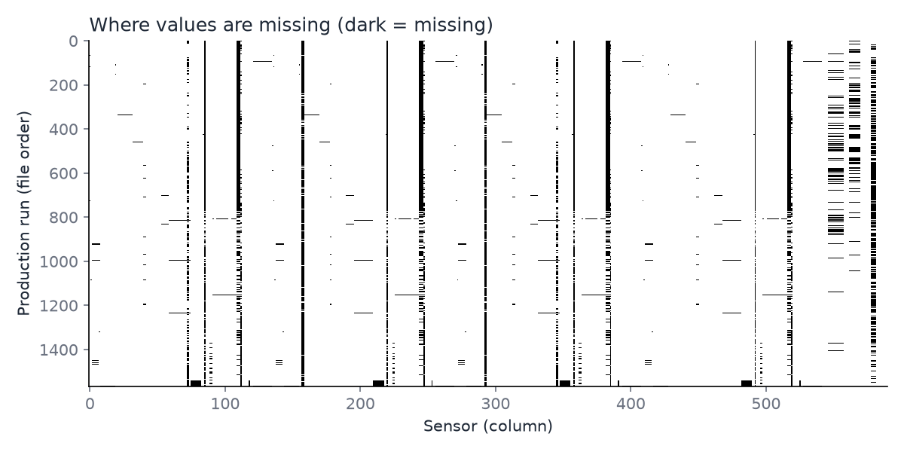

# SECOM data profile

Generated by `scripts/profile_secom.py` on 2026-10-11. Re-run it to regenerate this page and the charts.

Source: [UCI Machine Learning Repository, SECOM](https://archive.ics.uci.edu/dataset/179/secom). Files checked by SHA-256:

| File | SHA-256 |
|---|---|
| `secom.data` | `20f0e7ee434f7dcbae0eea9ffff009a2b57f42d6b0dc9a5bd4f00782c0a3374c` |
| `secom_labels.data` | `126884cf453705c9e61a903fe906f0665a3b45ce3639e621edc5c93c89627e03` |

## Shape

| Measure | Value |
|---|---|
| Production runs (rows) | 1,567 |
| Sensor measurements per run (columns) | 590 |
| Labels rows | 1,567 |
| Rows match between the two files | yes |

## Class balance

| Outcome | Runs | Share |
|---|---|---|
| Pass (label -1) | 1,463 | 93.4% |
| Fail (label 1) | 104 | 6.6% |

About **14.1 passes for every fail**.

## Missing values

| Measure | Value |
|---|---|
| Cells missing | 41,951 of 924,530 (4.5%) |
| Runs with at least one missing value | 1,567 of 1,567 (100.0%) |
| Runs with no missing values at all | 0 |

Sensors by how much of their data is missing:

| Missing | Sensors |
|---|---|
| none | 52 |
| under 5% | 486 |
| 5-20% | 20 |
| 20-50% | 4 |
| over 50% | 28 |

Most-incomplete sensors:

| Sensor | Missing |
|---|---|
| `s157` | 91.2% |
| `s292` | 91.2% |
| `s293` | 91.2% |
| `s158` | 91.2% |
| `s492` | 85.6% |
| `s358` | 85.6% |
| `s220` | 85.6% |
| `s085` | 85.6% |
| `s517` | 65.0% |
| `s518` | 65.0% |

## Sensors that carry no signal

| Measure | Sensors |
|---|---|
| Constant (one value, or no values, across all runs) | 116 |
| Near-constant (one value is at least 95% of readings) | 10 |

## Time order

| Measure | Value |
|---|---|
| First run | 2008-07-19 11:55 |
| Last run | 2008-10-17 06:07 |
| Days with at least one run | 86 |
| Runs out of time order (earlier than the run before, in file order) | 0 |
| Runs sharing a timestamp with an earlier run | 33 |
| Median time between runs | 0 days 00:38:00 |
| Longest gap between consecutive runs | 2 days 00:38:00 (after run 200) |

## What this means for the pipeline

- **Missing values are normal, not errors.** 100.0% of runs have at least one. Rejecting any run with a missing value would throw away 1,567 of 1,567 runs, so the validator records missing values and rejects only structurally broken records.
- **Not every sensor gets a control chart.** 116 sensors never change. Excluding those and any sensor missing more than 50% of readings leaves **446 monitorable sensors** (with a stricter 20% limit: 442). Proposed baseline rule: chart a sensor only if it varies and is missing at most 50% of the time; the final rule is set with the baseline limits in the health-signals epic.
- **Fails are rare** (about 1 in 15), so fail-risk is judged on recall, precision and PR-AUC, never accuracy: a model that always says pass would be 93.4% accurate and useless.
- **Time order:** the replay sends runs in file order. 0 runs are earlier than the run before them in the original timestamps, so each record carries the original timestamp for reference and a fresh send time as its event time.
